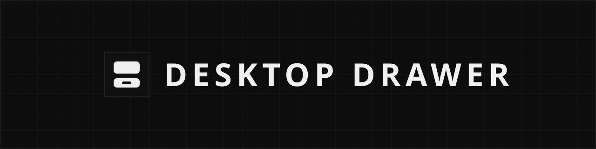

  

# Desktop Drawer

Turn the Windows desktop into a **paged desktop**. Desktop Drawer never moves, renames, or deletes your files. It draws a native-like icon grid over the wallpaper so a crowded desktop stays manageable.

## Features

- Icons are drawn directly on the wallpaper: no large title bar and no window frame.
- The window is **truly transparent**; wallpaper changes, slideshows, and live wallpapers show through.
- It never appears in the taskbar, Alt+Tab, or the window switcher, and it returns to the desktop after `Win+D`.
- It always sits above the desktop and below application windows, so it never covers a running app.
- Native Windows desktop icons are hidden while it runs and restored when it exits.
- Page with the mouse wheel, `PageUp` / `PageDown`, or the page dots.
- The header and footer fade out after about 2.4 seconds of inactivity and return when the mouse moves.

## Installation

Download the installer from the Releases page and run it. It installs per-user to `%LocalAppData%\DesktopDrawer` without administrator rights, adds a Start menu shortcut, and registers an uninstaller.

Requires Windows 10/11 and the .NET 9 Desktop Runtime.

## Shortcuts

| Action | How |
| --- | --- |
| Flip pages | Mouse wheel, two-finger pan on a touchpad, `PageUp` / `PageDown`, `Alt+←` / `Alt+→`, or the page dots |
| First / last page | `Ctrl+Home` / `Ctrl+End` |
| Search | `Ctrl+F` |
| Open | Double-click, or select and press `Enter` |
| Select | Click, `Ctrl+click`, `Shift+click`, or the arrow keys |
| View full file name | Click a truncated icon label; the label expands to show the full name |
| Rename | `F2` |
| Properties | `Alt+Enter` |
| Delete to Recycle Bin | `Delete` |
| Delete permanently | `Shift+Delete` |
| Copy files | `Ctrl+C` |
| Cut files | `Ctrl+X` |
| Paste to desktop | `Ctrl+V` |
| Copy file path | `Ctrl+Shift+C` |
| Select all on current page | `Ctrl+A` |
| Type-ahead | Start typing a file name to select the first matching item |
| Change icon size | `Ctrl+wheel`, or `Ctrl+Shift+1/2/3` (Compact / Cozy / Large) |
| Refresh | `F5` |
| New folder | `Ctrl+Shift+N` |
| Toggle native desktop icons | `Ctrl+Shift+H` |
| Close search / close panel | `Esc` |
| Context menu | Right-click an icon for the app-style menu; **More options...** or `Shift`+right-click opens the native Windows menu with all installed shell extensions |
| Empty-area right-click | New folder, refresh, grouping, hide native icons, settings, restart, or exit |
| Drag out | Drag an icon to File Explorer or another drop target |
| Drag in | Drop files onto the desktop area or a folder icon; `Ctrl` copies and `Shift` moves |

## Settings

The gear at the top right opens settings. If the header is hidden, move the mouse first.

- **Language**: English / 简体中文 / 繁體中文 / 日本語. Changes apply immediately.
- **Icon size**: Compact / Cozy / Large presets, or a custom 24–160 px size.
- **Text size**: 80%–140% global scale for headings, buttons, menus, the search box, and desktop icon names.
- **Style**: Open the style panel to pick a theme (Monochrome, Graphite, Ocean, Forest, Sunset, Nord, Paper) or fine-tune the accent, text levels, surfaces, panels, borders, danger color, and shade with the RGB picker.
- **Wallpaper dim**: Dim the wallpaper behind the overlay from 0% to 60%.
- **Grid**: Fit to the window automatically, or choose 2–16 columns and 1–16 rows. Separate column-gap and row-gap sliders (0–48 px) tune the spacing; **Reset spacing** restores the 4 px default.
- **Sorting**: Folders first and show hidden files.
- **Behavior**: Always show controls, close to tray, and start with Windows.
- **Desktop icons**: Hide or restore native icons immediately, or hide them on launch.

All settings save instantly.

## Layout and grouping

**Layout**: Settings → LAYOUT → **Adjust layout**. Drag the header, pager, group badge, summary, hint, and notification banner to move them; drag the edge and corner grips to resize. A notification preview appears while editing so you can place it where it is easy to see. **Reset** restores the defaults and **Done** exits.

**Manual adjustment**: Drag a single icon onto another to pin its position. The remaining icons keep sorting automatically; choose **Reset manual positions** in the sort menu to clear all pins.

**Custom groups**: Create, rename and reorder your own categories from Settings → CUSTOM GROUPS → **Manage groups**. A two-pane editor lists groups on the left and the selected group's rules on the right. Click **Reorder**, drag a group into place with its handle, then **Done**; or use the sort button beside **Add group** to sort by name or item count. The built-in categories (Documents, Images, Videos, Audio, Archives, Programs) are pre-created with their file types. Add suffixes, browse for a file to copy its type, match file names (ignoring the extension), or click **All folders** to include every folder and replace the other filter tags; click the folder tag to narrow it to specific names (case-sensitive). A new name fragment that duplicates or overlaps an existing one is rejected with a notice for both file and folder filters. Right-click icons and choose **Groups** to override the rules, then choose **Group by → Custom** to show these categories in the page bar.

**Grouping**: Right-click the desktop and choose **Group by** to group by type, name, or date modified. Files are never moved; icons in the same group are simply placed on the same page range. Choose **None** to return to ungrouped pages.

## Updates

Use **Update now** in ABOUT to check for updates, install them, and restart automatically. Settings are preserved.

## Native desktop icons

Desktop Drawer hides the native Windows desktop icons while it is running and restores them when it exits, including after a crash. Closing to the tray also restores them first.
